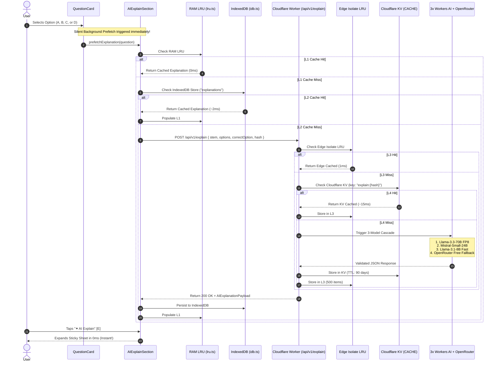

# AGENTS.md — BankIntel Architecture & Engineering Guide

> **Audience:** AI Assistants and Senior Engineers working on the BankIntel codebase.  
> **Purpose:** Authoritative reference for system architecture, the edge AI explanation cascade, multi-tier caching, bitmask indexing, PWA service worker resilience, and development workflows.

---

## 1. System Overview & Monorepo Topology

BankIntel is an ultra-fast, mobile-first, offline-first Progressive Web App (PWA) tailored for candidates preparing for **Bangladesh Bank (BB)** and **Bankers' Selection Committee (BSC)** recruitment examinations (AD, Officer Cash, Senior Officer IT, and Combined Bank Senior Officer).

### Workspace Layout

```
bankjob/
├── AGENTS.md                 # THIS FILE — Primary entry point for AI assistants
├── README.md                 # Public documentation and feature overview
├── worker/                   # Cloudflare Worker (Edge AI Cascade Backend)
│   ├── wrangler.jsonc        # Worker configuration, KV namespaces, and AI bindings
│   ├── package.json          # Worker dependencies & scripts
│   ├── src/
│   │   ├── index.ts          # Edge entry point, route dispatch, CORS handler
│   │   ├── cascade.ts        # 3x Workers AI + OpenRouter free cascade & JSON parsers
│   │   ├── cache.ts          # L3 Isolate LRU (500 items) + L4 Cloudflare KV (90-day TTL)
│   │   ├── ratelimit.ts      # In-memory sliding window rate limiter (O(1), zero KV cost)
│   │   └── types.ts          # Shared TypeScript contracts & schemas
│   └── test/
│       └── writing-validation.test.ts # Edge rubric & writing validator tests
├── web/                      # Next.js 16 App Router Frontend (PWA)
│   ├── package.json          # Next.js 16.4.3, React 19, Tailwind, KaTeX
│   ├── next.config.ts        # Next.js & Turbopack configurations
│   ├── app/                  # App Router screens
│   │   ├── layout.tsx        # Root layout, theme boot script, SW registration, chunk recovery
│   │   ├── globals.css       # Design tokens, CSS variables, Fraunces/Noto Serif styling
│   │   ├── page.tsx          # Practice Mode: Bitmask index, shard picker, MCQ card
│   │   ├── simulate/page.tsx # 60-min, 100-question Simulator (-0.25 marking)
│   │   ├── vault/page.tsx    # Mistake Vault with 3-repetition spaced graduation
│   │   ├── writing/page.tsx  # Subjective Written Preparation Mode
│   │   ├── error.tsx         # Local ErrorBoundary
│   │   └── global-error.tsx  # Root crash fallback
│   ├── components/           # UI components
│   │   ├── mcq/
│   │   │   ├── QuestionCard.tsx      # Core MCQ card (Stem, 4 OptionRows, AIExplainSection)
│   │   │   ├── OptionRow.tsx         # Pill-styled interactive option row
│   │   │   ├── AIExplainSection.tsx  # Always-visible toggle pill & sticky modal drawer
│   │   │   └── MathText.tsx          # Resilient KaTeX renderer ($math$ and $$math$$)
│   │   ├── layout/
│   │   │   ├── HeaderNav.tsx         # Brand, 4-pill desktop nav, Theme & Bengali toggle
│   │   │   ├── MobileBottomNav.tsx   # 4-pill mobile bottom nav (Practice, Sim, Vault, Writing)
│   │   │   └── DesktopNav.tsx        # Desktop top tab navigation
│   │   ├── writing/
│   │   │   ├── WritingWorkspace.tsx  # Split-pane reading & practice workspace
│   │   │   └── AnswerMarkdown.tsx    # Markdown + KaTeX model answer renderer
│   │   ├── decor/
│   │   │   └── Petals.tsx            # Falling sakura petals signature background
│   │   └── pwa/
│   │       └── PWAInstallBanner.tsx  # Native PWA install prompt banner
│   ├── lib/
│   │   ├── cache/lru.ts      # L1 Client-side in-memory LRU cache (250 entries)
│   │   ├── db/idb.ts         # L2 IndexedDB engine (attempts, bookmarks, explanations)
│   │   ├── search/bitmask-index.ts # O(N/32) bitwise faceted search index
│   │   ├── i18n/             # English ⇄ Bengali translations & context
│   │   ├── types.ts          # Frontend data contracts
│   │   └── writing.ts        # Subjective writing shard loader & validator
│   ├── public/
│   │   ├── sw.js             # Service Worker (bank-intel-v5): offline precache & network-first
│   │   ├── manifest.json     # PWA Web App Manifest
│   │   └── shards/           # Static question banks
│   │       ├── manifest.json # Shard registry & hash metadata
│   │       ├── bb-ad-2026.json
│   │       ├── bb-so-it-2026.json
│   │       ├── bb-cash-2023.json
│   │       ├── bsc-so-2026.json
│   │       ├── writing-index.json
│   │       └── writing-officer-it.json
│   ├── scripts/
│   │   └── validate-shards.mjs # Shard schema & KaTeX balance validator
│   └── test/
│       ├── bitmask.test.ts   # Bitmask index bitwise performance tests
│       ├── writing.test.ts   # Writing shard schema validation tests
│       ├── shards.test.ts    # 100% manifest and question shard integrity tests
│       └── smoke-and-screenshots.ts # Headless Chrome 48-viewport regression harness
└── scraper/                  # Offline Python/Node scrapers for past exam PDFs
```

---

## 2. The AI Explain Pipeline

The AI Explanation feature is **dynamic, per-option, and runs on an edge cascade**. There are no hardcoded question explanations in the JSON shards; every explanation is generated on-demand by Cloudflare Workers AI or OpenRouter free models and cached across 4 tiers.

### End-to-End Execution Flow



### 1. Client-Side Background Prefetching
- In `web/components/mcq/AIExplainSection.tsx`, a background prefetch (`prefetchExplanation`) is dispatched **the instant the user taps any option** (before they even tap the AI Explain button).
- By the time the user reads the result and taps **"✦ AI Explain"** or presses `[E]`, the explanation is already in L1/L2 and renders in `0ms`.
- The toggle pill displays a green `Ready` (`প্রস্তুত`) badge once the payload is cached.

### 2. Edge Worker Cascade (`worker/src/cascade.ts`)
The worker does not rely on a single model. It cascades through 3 native Cloudflare Workers AI models and a free OpenRouter backup pool:

1. **Tier 1 (Flagship Reasoning):** `@cf/meta/llama-3.3-70b-instruct-fp8-fast`
2. **Tier 2 (Fast Math/Deduction):** `@cf/mistralai/mistral-small-3.1-24b-instruct`
3. **Tier 3 (Ultra-Low-Latency Fallback):** `@cf/meta/llama-3.1-8b-instruct-fast`
4. **Tier 4 (Zero-Cost External Fallback):** `openrouter/free` (Meta-Llama 3.3 70B, DeepSeek R1, Qwen 2.5 72B free endpoints).

### 3. Strict JSON Contract
The edge worker guarantees clean JSON output using `extractAndValidateJson()`. Even if models emit markdown code blocks or conversational prefixes, the parser isolates `{ ... }` boundaries and verifies every required key:
- `coreConcept`: 1-line fundamental formula or grammar/GK rule.
- `examHallShortcut`: Under 30-second mental trick or elimination heuristic.
- `stepByStep`: Concise step-by-step derivation.
- `optionDiagnostics`: Explicit breakdown for all 4 options (`A`, `B`, `C`, `D`), indicating why the correct choice is right and what cognitive or mathematical trap each distractor represents.

---

## 3. Multi-Tier Caching Architecture

| Tier | Layer | Location | Structure | Lookup Time | Eviction & Lifecycle |
|---|---|---|---|---|---|
| **L0** | LocalStorage | Browser Client | Key-Value (`bi-theme`, `boot_summary_v1`) | $O(1)$ sync | Persistent; zero-CLS first paint |
| **L1** | RAM LRU | React Context | `Map<string, Node>` + Doubly Linked List | $O(1)$ (< 0.1ms) | Max 250 explanations in RAM |
| **L2** | IndexedDB | Browser IDB | Object Store: `explanations` (key: `hash`) | $O(\log N)$ (~2ms) | Persistent offline store |
| **L3** | Edge LRU | Cloudflare Worker Isolate | In-memory `Map` | $O(1)$ (~1ms) | Max 500 entries per edge isolate |
| **L4** | Cloudflare KV | Cloudflare Global Edge | KV Namespace: `CACHE` | $O(1)$ (~15ms) | 90-day TTL (`7,776,000` seconds) |

---

## 4. Algorithmic Complexity & Multi-Facet Filtering

### Bitmask Inverted Index (`web/lib/search/bitmask-index.ts`)
- **Problem:** Scanning 5,000+ questions with `Array.prototype.filter()` across multiple facets (`year === 2026 && subject === 'MATH'`) causes jank on low-end mobile devices ($O(N \times F)$ per filter stroke).
- **Solution:** On shard load, each question receives a dense integer index $i \in [0, N-1]$. The app constructs an Inverted Bitset Index using `Uint32Array` where each facet value (`SUBJECT:MATH`, `TOPIC:Algebra`, `HAS_MATH:true`) maps to a bitset of length $\lceil N / 32 \rceil$.
- **Complexity:** Intersecting $k$ filters performs bitwise AND (`bitmapA[w] & bitmapB[w]`) across 32 questions per CPU instruction.
  - **Time Complexity:** $O(N / 32)$ bitwise ops ($\approx 0.02\text{ms}$ for $N = 10,000$).
  - **Space Bound:** $O(F \cdot \lceil N / 32 \rceil)$ bytes ($\approx 12\text{ KB}$ total RAM).

---

## 5. Subjective Written Preparation Mode (`/writing`)

Added in commit `f8c9da3`, `/writing` addresses the second phase of Bangladesh Bank & Combined Bank recruitment: 200-mark written exams (creative essay, critical writing, translations, mathematical deductions, and IT technical briefs).

### Key Components
1. **Written Shard Format:**
   - Shards live in [`web/public/shards/`](file:///Users/bikashtalukder/bankjob/web/public/shards/) (`writing-index.json`, `writing-officer-it.json`).
   - Every question contains:
     - `questionEn` / `questionBn`
     - `marks` & `timeBudgetMinutes`
     - `modelAnswerEn` & `modelAnswerBn` (structured with KaTeX and Markdown)
     - `evaluationRubric` (5 specific evaluation criteria with weights)
     - `commonPitfalls` (common reasons candidates lose marks)
2. **Writing Workspace (`web/components/writing/WritingWorkspace.tsx`):**
   - Split-view / responsive drawer with Question Stem, Timer, Live Word Counter, and Bengali Typing Helper.
   - Dual-tab Model Answer viewer with bilingual toggle.
3. **AI Edge Review Endpoint (`POST /api/v1/explain-writing`):**
   - Cloudflare Worker accepts `{ questionId, questionText, marks, evaluationRubric, candidateAnswer }`.
   - Generates an objective, structured evaluation: `overallScore`, `strengths`, `weaknesses`, `rubricScores`, and `actionableAdvice`.

---

## 6. Service Worker & PWA Resiliency (`web/public/sw.js`)

The PWA is offline-capable under cache version **`bank-intel-v5`**.

### Critical Invariants to Prevent Navigation Crashes
1. **Never Allow `event.respondWith` to Reject:**
   Chromium intercepts any unhandled promise rejection in `event.respondWith()` and replaces the viewport with *"This page couldn't load. Reload to try again, or go back."* All fetch calls in `sw.js` must end with `.catch()` returning a cached fallback or standard HTTP response.
2. **Never Cache `Request` with `mode: 'navigate'` Directly:**
   Always cache and match navigation requests using URL strings (`event.request.url` or `'/'`), not raw `Request` objects.
3. **Network-First for HTML:**
   HTML navigation requests (`/`, `/writing`) are network-first so new Next.js chunk hashes are loaded immediately when deployed. Only when network drops does it fallback to offline cache or `OFFLINE_HTML`.
4. **Chunk Skew Auto-Recovery:**
   In [`web/app/layout.tsx`](file:///Users/bikashtalukder/bankjob/web/app/layout.tsx), a global window error listener catches `Loading chunk ... failed` or dynamic import failures and triggers a single controlled reload to resync chunk hashes.

---

## 7. Design System & Tokens

The visual system adheres strictly to the **Bank-Intel Academic Glass** specification:

### CSS Custom Properties (`web/app/globals.css`)

```css
/* Light Mode (Default) */
:root {
  --bg: #fdfbfa;
  --surface: #ffffff;
  --surface2: #f8f1f2;
  --line: #efe3e5;
  --ink: #2a1a20;
  --mute: #8a7479;
  --brand: #9b2243;       /* Burgundy */
  --brand-ink: #ffffff;
  --pill: #27352b;        /* Dark Forest Green */
  --pill-ink: #ffffff;
  --ok: #2f7a4f;
  --okbg: #e8f4ec;
  --bad: #b3243b;
  --badbg: #fbe8eb;
  --shadow: 0 18px 50px -24px rgba(155, 34, 67, 0.35);
  --petal: 0.9;
}

/* Dark Mode (Obsidian & Rose) */
:root[data-theme="dark"] {
  --bg: #0c0a0e;
  --surface: #16131a;
  --surface2: #1e1a24;
  --line: #2a2530;
  --ink: #f6ecef;
  --mute: #a1939a;
  --brand: #ff8fab;       /* Rose */
  --brand-ink: #2a0a14;
  --pill: #f6ecef;
  --pill-ink: #16131a;
  --ok: #6fd49a;
  --okbg: #14291e;
  --bad: #ff8a9b;
  --badbg: #301319;
  --shadow: 0 18px 50px -24px rgba(0, 0, 0, 0.8);
  --petal: 0.12;
}
```

### Typography Hierarchy
- **Serif Display & Stems:** Google Font **Fraunces** (`opsz 9..144`, weights 500, 600) + Google Font **Noto Serif Bengali**.
- **Body & Options:** System UI sans-serif + **Hind Siliguri** for Bengali prose.
- **Math & Equations:** KaTeX with custom `$inline$` and `$$block$$` rendering via [`MathText.tsx`](file:///Users/bikashtalukder/bankjob/web/components/mcq/MathText.tsx).

---

## 8. Verification & Testing Commands

Before pushing any commit, run this fast feedback loop:

```bash
# 1. Typecheck the entire Next.js codebase
cd web && npm run typecheck

# 2. Run all unit tests (Bitmask, Shards, Writing)
cd web && npm test

# 3. Validate static shard integrity & KaTeX delimiter balance
node web/scripts/validate-shards.mjs

# 4. Test Edge Worker types & cascade schemas
cd ../worker && npm run typecheck

# 5. Build Next.js production bundle
cd ../web && npm run build
```

---

## 9. Standing Git Rules for Autonomous Agents

1. **Explicit Permission Required for Commits & Pushes:**  
   Always stage files by name, present the draft commit message, and wait for the user's explicit instruction before committing or pushing.
2. **Never Use Destructive Git Commands:**  
   No `git push --force`, `git reset --hard`, `git clean -f`, or `git checkout .`.
3. **Stage By Name Only:**  
   Never use `git add .` or `git add -A` to prevent accidentally committing `.env` files or temporary build artifacts.
4. **Preserve Scoring & Academic Rigor:**  
   The $-0.25$ negative marking formula and official answer keys must never be altered or hardcoded.
